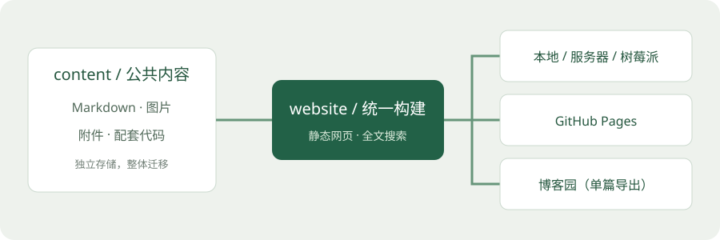

<!-- note {"tags": ["使用指南", "Markdown", "知识管理"], "keywords": ["notes-record", "AI", "skill", "笔记规范"], "updated": "2026-11-04"} -->
# 笔记使用说明

这个知识库以 Markdown 为核心，根目录为 `E:\codex_prj\Notes`。阅读和查询通过网站进行；你可以使用文本编辑器手动撰写，也可以让 AI 工具按照 `notes-record` skill 将分析、排查和实践整理成文章。两种方式使用相同的内容目录、资源规则和构建入口，可以交替使用。

## 一份内容，多种去处



笔记正文放在 `content/notes/`，按知识主题分层；图片、原始资料和相关代码分别放在公共目录。部署入口共用同一个构建程序，不维护多份正文。

你已有的示例已经整理到 [Altium 3D 模型对齐教程](electronics/altium/Altium_24_3D_Model_Alignment_TE1410142-1.md)，原文内容保持不变。

## 手动撰写笔记

1. 复制根目录下的 `templates/note.md`，放入 `content/notes/` 中合适的主题目录。
2. 使用稳定且唯一的英文短名作为 `note-id`，例如 `my-note`，将文章命名为 `my-note.md`。标题可以使用中文，标题修改后无需改文件名。
3. 按目标与背景、环境、操作过程、结果和回顾整理正文。排查类文章补充复现条件、关键证据、尝试过的方案、原因分析和验证结果，明确区分已验证结论与推测。
4. 将实际用到的资源按下节规则保存并引用，填写标签与维护日期，然后重新构建预览。

Markdown 正文使用一个一级标题，章节使用二、三级标题；列表、表格和代码块前后留空行。代码块标注语言，例如 `python`、`powershell`、`text`。短代码可写入正文，完整可运行脚本单独保存并链接，说明运行环境、依赖、参数与成功判据。文件使用 UTF-8 编码。

## 建立笔记与资源

所有路径均以 `E:\codex_prj\Notes` 为根目录：

| 内容 | 存放目录 | 说明 |
| --- | --- | --- |
| Markdown 文章 | `content/notes/<主题>/<note-id>.md` | 按主题归类，可多级目录 |
| 图片 | `content/images/<note-id>/` | 截图、示意图，建议按序命名 |
| 代码 | `content/code/<note-id>/` | 完整源码、脚本、示例配置 |
| 其他附件 | `content/attachments/<note-id>/` | 日志、PDF、设计文件、数据和压缩包 |

只创建实际用到的资源目录。不要将编辑器缓存、虚拟环境或临时文件放入内容目录。

例如建立一篇 `content/notes/electronics/altium/my-note.md`，其资源可以放在：

```text
content/images/my-note/01-overview.png
content/attachments/my-note/datasheet.pdf
content/code/my-note/example.py
```

这篇位于三级分类目录的笔记应这样引用：

```markdown

[产品资料](../../../attachments/my-note/datasheet.pdf)
[配套脚本](../../../code/my-note/example.py)
```

这些只是语法示例，实际引用前需要将对应文件放入目录。资源目录名称使用稳定且唯一的 note-id，正文标题调整后资源不必改名。

相对路径从文章所在目录计算，统一使用 `/`；以上 `../../../` 只适用于示例目录层级。文章链接的本地文件必须实际存在且位于 `content/` 中，不使用 Windows 绝对路径或 `build/site/` 路径作为资源链接。新资源名尽量不含空格，已有文件名中的空格在链接中写为 `%20`。图片需要有意义的说明文字，附件标明用途。

当前支持标准 Markdown、表格、代码块和目录等扩展；未配置公式、Mermaid 或专门的任务列表渲染。需要图示时引用实际图片或 SVG 文件。

## 使用 AI 按 skill 生成文章

`notes-record` skill 已安装到本机 Codex，项目中也保留了一份，便于其他 AI 工具读取：

| 文件 | 本机绝对路径 |
| --- | --- |
| 项目中的 skill 规则 | `E:\codex_prj\Notes\skills\notes-record\SKILL.md` |
| 排查记录文章模板 | `E:\codex_prj\Notes\skills\notes-record\assets\troubleshooting-note.md` |
| Codex 已安装的 skill | `C:\Users\Lenovo\.codex\skills\notes-record\SKILL.md` |

这些是提供给 AI 工具读取的本机路径，不是站点资源链接；skill 文件不在 `content/` 中，不会随网站发布。项目副本与已安装副本为独立文件，修改规则后需同步更新。

### 在 Codex 中调用

分析、排查或实验完成后，在保留相关上下文的对话中发送：

```text
使用 $notes-record，将这次分析排查整理为完整的 Notes 笔记。
保存实际配套代码、图片和附件，区分已验证结论、推测和待办事项，
构建检查后给出文章和本地预览的绝对路径。
```

需要指定分类或更新已有文章时，在请求中补充目标主题目录或文章路径。例如：“归入 electronics/jtag；如果已有同一问题的笔记，就补充原文。”

### 在其他 AI 工具中使用

将项目中的 `SKILL.md` 及配套文章模板提供给工具，或让具有本地文件读取能力的工具按以下提示执行：

```text
请读取 E:\codex_prj\Notes\skills\notes-record\SKILL.md，
以及其中引用的文章模板，按规则将本次问题分析整理为完整记录。
Notes 根目录为 E:\codex_prj\Notes。
请保存 Markdown 与实际配套资源，完成构建检查，并报告预览路径。
```

如果工具无法直接访问本机文件，可提供上述两个文件的内容，让它输出文章、资源清单及目标路径，再手动保存到 Notes。没有实际访问文件或运行检查的工具，应明确说明未执行的步骤；本地保存后再按下文验证。

### 生成后检查什么

- 文章是否保留环境、复现步骤、关键证据、处理方案和实际验证结果；尚未解决时是否写明阻塞与下一步。
- 是否区分实际观察、推测和已验证结论，避免补造截图、日志或成功结果。
- 配套代码、图片与附件是否真实存在、路径是否正确；缺失资料应说明，不插入失效链接。
- 日志、截图和配置是否完成必要脱敏。网站会提供 `content/` 中的内容与源文件供访问，不要放入密钥、令牌或不适合公开的资料。

AI 生成后可以继续手动修改；手动撰写的文章也可以交给 AI 补充整理。归档与本地构建不代表发布到外网。

## 标签与分类

分类由笔记所在文件夹自动生成。文首可使用不会影响 Markdown 阅读的 JSON 注释：

```markdown
<!-- note {"tags": ["Altium", "PCB", "3D模型"], "keywords": ["STEP"], "updated": "2026-11-04"} -->
# 标题
```

`tags` 与 `keywords` 用于搜索和关键词聚合；知识主题按网站规则自动匹配，一篇文章可以属于多个主题。`updated` 填实际维护日期，不依赖文件修改时间。没有注释的笔记仍可展示。

## 回顾学习

1. 用首页搜索查找知识点，正文内容也可以搜索。
2. 在文章页点击“加入待复习”。
3. 返回首页勾选“待复习”，集中查看需要巩固的笔记。
4. 复习后可移除标记，把新理解补充到 Markdown 源文件。

复习列表只保存在当前浏览器中，不跨设备同步。直接打开 HTML 的离线模式下，浏览器可能按文件隔离或禁止本地存储，因此复习标记可能无法跨页面共享；需要稳定使用此功能时使用 HTTP 入口。重要的学习结论和长期计划应写入 Markdown。

## 配套代码示例

[示例脚本](../code/getting-started/hello.py) 演示如何保存配套代码。本网站展示或下载文件，不在服务端执行笔记附带的代码。

## 更新网站

手动撰写或 AI 生成后，都需要重新构建。推荐双击根目录的 **`生成并预览.cmd`**：自动构建网站，启动仅本机可访问的 HTTP 服务并打开浏览器，默认端口 8000 被占用时自动选择可用端口。保留命令窗口，按 Ctrl+C 停止服务；修改内容后重新运行脚本。

只需离线阅读时，双击 **`启动笔记.cmd`**，自动构建并打开 `build/site/index.html`，不启动 HTTP 服务。

也可以在 PowerShell 中手动构建并检查：

```powershell
Set-Location -LiteralPath 'E:\codex_prj\Notes'
& '.\.venv\Scripts\python.exe' website/check.py
```

`website/check.py` 会重新构建并检查内部链接。仅生成网站可运行 `website/build.py`。构建失败时先根据错误中的文章路径修复失效资源链接，再重新运行。

构建成功后，首页位于 `E:\codex_prj\Notes\build\site\index.html`，本说明页位于 `E:\codex_prj\Notes\build\site\notes\getting-started.html`。不要直接修改 `build/site/` 中的文件，下次构建会更新它们。首次安装环境、迁移和各平台发布步骤请查看项目根目录的 `README.md`。

## 一键推送 GitHub 与 Pages 预览

### 首次准备

1. 安装 Git for Windows，并按根目录 `README.md` 配好 `.venv` 与网站依赖。
2. 在 GitHub 创建一个仓库，例如 `Notes`。首次从本地推送时建议创建空仓库，不预先添加 README、License 或 `.gitignore`。使用公开仓库时，提交的源码与资料也会公开。
3. 双击 `E:\codex_prj\Notes\一键推送.cmd`。尚未初始化 Git 时脚本会创建 `main` 分支；缺少 Pages 工作流时会从项目模板复制。尚未配置 `origin` 时，按提示输入自己的仓库地址，例如 `https://github.com/你的用户名/Notes.git`。已配置的仓库地址会沿用，不会覆盖。
4. 查看推送目标和变更清单，确认后按 Enter，输入 `q` 回车可取消。按提示填写提交说明，直接回车使用日期作为说明；缺少 Git 作者信息时按提示填写，仅保存到当前仓库。首次推送按 Git 的提示完成登录，HTTPS 不使用 GitHub 账户密码，通常通过 Git Credential Manager 完成浏览器授权；SSH 地址需事先配置 SSH 密钥。
5. 在 GitHub 仓库中打开 `Settings → Pages → Build and deployment → Source`，选择 **GitHub Actions**。到 `Actions` 查看 `Deploy learning notes`；如果首次部署因 Pages 尚未启用而失败，设置后重新运行工作流。

### 日常更新

手动或 AI 生成笔记后，双击 **`一键推送.cmd`**，查看变更清单，按 Enter 确认并输入提交说明即可。脚本先运行 `website/check.py`，构建和链接检查通过后才会执行提交与推送。没有文件变更时，仍会尝试推送已有提交，适合网络恢复后重试。

脚本会提交全部未忽略的新增、修改和删除，包括之前已暂存的文件，不只提交文章。`.venv/`、`build/`、`exports/`、`.vs/` 等按 `.gitignore` 排除；已经被 Git 跟踪的文件不会因为后来加入忽略规则而自动排除。确认清单时检查密钥和私人资料是否误入。

推送成功后，GitHub Actions 会构建并部署站点。请等待 Actions 完成，再访问 `https://你的用户名.github.io/Notes/`（仓库名不同则替换 `Notes`）。脚本显示推送成功仅表示 Git 推送成功，部署是否成功以 Actions 页面为准。

### 启用 GitHub Pages 并通过网址访问

当前项目使用 GitHub Actions 将 Markdown 构建为静态网页；推送源码后由 GitHub 自动部署，无需上传本机的 `build/site/`。

1. 打开 [Notes 仓库](https://github.com/sunzhongmeng/Notes)，进入 **Settings → Pages**。
2. 在 **Build and deployment → Source** 中选择 **GitHub Actions**。项目已提供 `.github/workflows/pages.yml`，无需再选择其他站点模板。
3. 双击本机的 `E:\codex_prj\Notes\一键推送.cmd`，查看变更、确认提交并推送。
4. 打开仓库的 [Actions 页面](https://github.com/sunzhongmeng/Notes/actions)，查看与最新提交对应的 **Deploy learning notes**，等待构建和部署任务均显示绿色成功。若之前因 Pages 尚未启用而失败，完成设置后打开失败的运行记录，点击 **Re-run all jobs**。
5. 回到 **Settings → Pages**，通过 **Visit site** 打开站点；也可以在浏览器地址栏直接输入下面的网址。

| 入口 | 地址 | 用途 |
| --- | --- | --- |
| GitHub 仓库 | [sunzhongmeng/Notes](https://github.com/sunzhongmeng/Notes) | 查看和管理源文件 |
| 笔记网站首页 | [在线笔记](https://sunzhongmeng.github.io/Notes/) | 阅读、搜索和浏览笔记 |
| 本篇说明 | [在线笔记使用说明](https://sunzhongmeng.github.io/Notes/notes/getting-started.html) | 直接打开本说明 |

上述网站地址在 Pages 成功部署后可用。地址中的仓库名为 `Notes`，访问时保留对应大小写和路径。后续每次推送 `main` 都会触发自动部署，不必重复设置 Pages。更改发布后可能需要几分钟才可看到，GitHub 官方说明最长可能需要约 10 分钟；先确认 Actions 完成，再刷新页面。

设置步骤与发布等待时间可参考 [GitHub Pages 发布源配置](https://docs.github.com/en/pages/getting-started-with-github-pages/configuring-a-publishing-source-for-your-github-pages-site) 和 [查看发布的网站](https://docs.github.com/en/pages/getting-started-with-github-pages/creating-a-github-pages-site)（访问日期：2026-11-04）。

### 在 GitHub 个人主页添加入口

打开自己的 [GitHub 个人主页](https://github.com/sunzhongmeng)，点击 **Edit profile**，在网站地址字段中填写 `https://sunzhongmeng.github.io/Notes/` 并保存。这样，别人可以从个人资料中的网站链接进入笔记；设置个人资料链接与启用 Pages 是两件独立的事，网站需要先部署成功。

当前使用的是项目站点地址 `https://sunzhongmeng.github.io/Notes/`。如果以后希望用根地址 `https://sunzhongmeng.github.io/`，需要在名为 `sunzhongmeng.github.io` 的仓库中配置个人站点；现有 Notes 项目无需为此更名或迁移。

### 失败时处理

- 构建或链接检查失败：根据文章路径修复内容，重新双击脚本。
- 登录、权限或网络失败：检查 GitHub 登录和仓库地址，恢复后重试；本地已完成的提交会保留。
- 提示远端有本地没有的提交：先手动拉取并处理差异，再重试。脚本不会强制推送、自动拉取或自动合并。
- 当前分支不是 `main`，或存在未完成的合并、变基或冲突：先手动处理分支或冲突，确保与 Pages 工作流配置一致。
- 网页返回 404：检查访问地址是否包含 `/Notes/`，并确认 Pages 发布源为 GitHub Actions、最新部署成功；以 Settings → Pages 中显示的站点地址为准。
- 推送成功但网页内容未更新：先检查最新提交对应的 Actions 是否完成，查看失败任务日志；成功后等待发布生效，再强制刷新浏览器（Ctrl+F5）。

脚本实现位于根目录的 `deploy/github-pages/push.py`。需要在终端运行时可使用：

```powershell
Set-Location -LiteralPath 'E:\codex_prj\Notes'
& '.\.venv\Scripts\python.exe' deploy/github-pages/push.py
```
